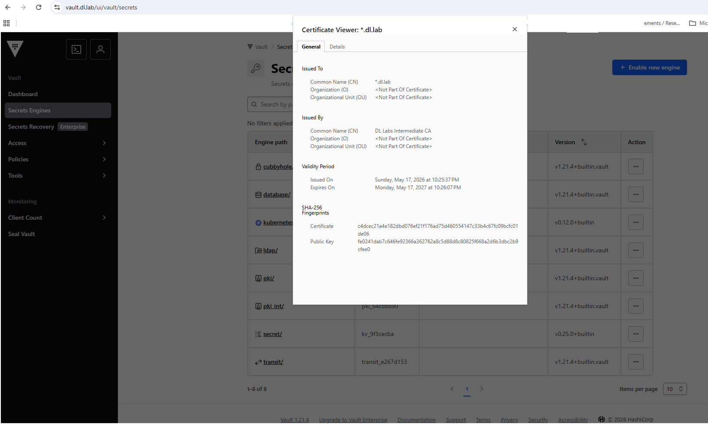
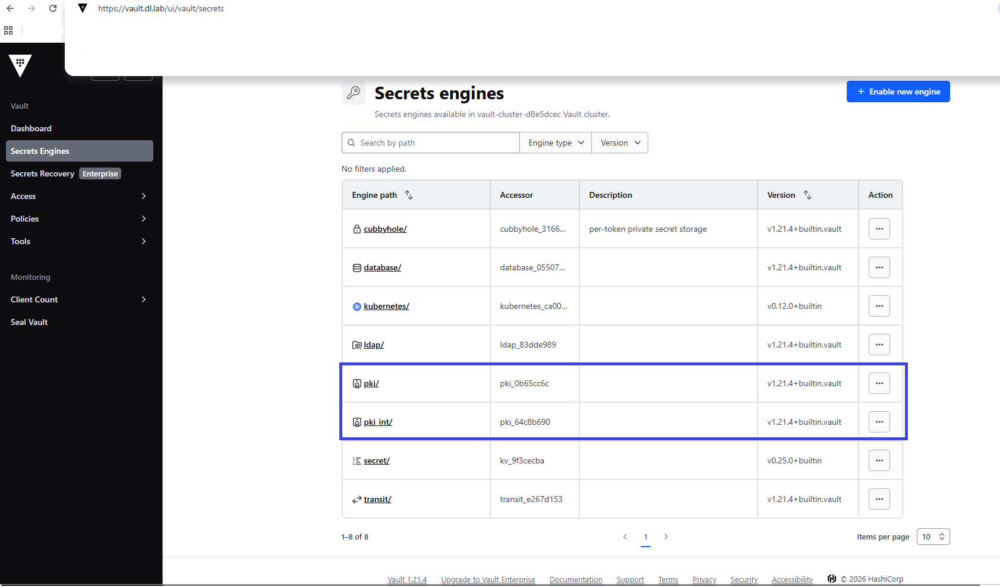
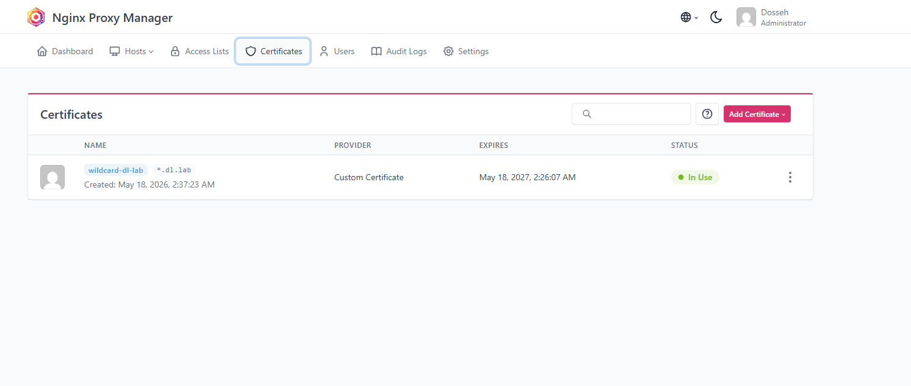
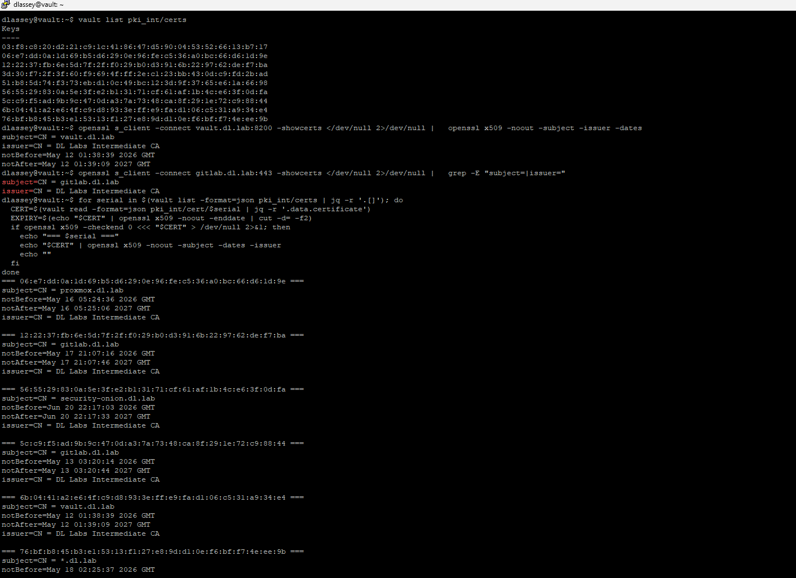

<div align="center">

# 🔐 Vault PKI — Internal Certificate Authority


---

> **DL Labs | Security Track — SEC-002**
> Part of the [DL Labs](https://github.com/dlassey-labs) self-hosted infrastructure programme.


</div>

---

## Overview

This project documents the design and implementation of an enterprise-style internal **Public Key Infrastructure (PKI)** for DL Labs, using an offline Root CA as the trust anchor and **HashiCorp Vault** as the online Intermediate CA.

Scope of this document: **PKI — Root CA, Intermediate CA, and TLS certificate issuance.**
Vault KV secrets management is documented separately (SEC-001).

**Key outcomes:**

- Two-tier CA hierarchy: offline Root CA + Vault-managed Intermediate CA
- HTTPS enabled for all internal services under `*.dl.lab`
- Role-based certificate issuance with domain and TTL restrictions
- Hybrid certificate strategy — wildcard for standard services, individual certs for critical services
- Least-privilege Vault policies for automation tokens
- Trust store distribution requiring both Root CA and Intermediate CA certificates
- Foundations for Zero Trust — machine and service identity

---

## Architecture

```text
┌──────────────────────────────────────────────┐
│         ROOT CA (OFFLINE VM)                 │
│  Air-gapped VM, no network interface         │
│  4096-bit RSA, AES-256 encrypted key         │
│  SHA-256, 10-year validity                   │
│  Powered off by default — started only to    │
│  sign Intermediate CA CSRs (every 3–5 years) │
└─────────────────┬────────────────────────────┘
                  │ signs (OpenSSL)
                  ▼
┌──────────────────────────────────────────────┐
│    VAULT INTERMEDIATE CA (ONLINE)            │
│  vault.dl.lab — PKI secrets engine           │
│  Role-based issuance: dl-lab role            │
│  Policy-restricted automation tokens         │
│  CRL distribution + audit logging            │
└─────────────────┬────────────────────────────┘
                  │ issues (Vault API)
                  ▼
┌──────────────────────────────────────────────┐
│       SERVICE CERTIFICATES (*.dl.lab)        │
│  Wildcard: standard services via NPM         │
│  Individual: Vault, GitLab, Wazuh, Nextcloud │
│  Managed lifecycle: issue → renew → revoke   │
└──────────────────────────────────────────────┘
```

**Why two tiers?** If the Intermediate CA is compromised, the response is contained: revoke the Intermediate, start the offline Root CA VM, sign a new CSR, and reissue service certificates. The Root CA and the global trust anchor remain intact. A single-tier hierarchy (Root CA issuing directly) would require rebuilding the entire PKI and redistributing a new Root CA to every client on compromise.

---

## Environment


| Component | Value | Purpose |
|---|---|---|
| HashiCorp Vault | v1.21.4 (OSS) | Intermediate CA, PKI secrets engine, policy engine |
| OpenSSL | 3.x | Root CA generation, Intermediate signing |
| Proxmox VE | 9.2.3 | VM management, air-gapped Root CA hosting |
| Root CA | Offline, air-gapped VM, RSA 4096 | Trust anchor, 10-year validity |
| Intermediate CA | Online, Vault `pki/` engine (chain ref) + `pki_int/` engine (operational) | Issues all service certificates |
| Issuance role | `dl-lab` (`*.dl.lab`, max TTL 8760h) | Domain-restricted certificate issuance (replace with your own domain )|
| Nginx Proxy Manager | v2.14.0 | TLS termination, wildcard certificate distribution for `*.dl.lab` |

---

## Design Decisions

| Decision | Rationale |
|---|---|
| *Offline Root CA* | Intermediate compromise is recoverable (revoke, re-sign) without rebuilding the trust chain. Root never touches a network. |
| *Two PKI engines* | `pki/` holds the root chain reference; `pki_int/` is the operational Intermediate. Clean separation. |
| *Non-routable internal domain* | Internal services don't need internet-routable domains. Certificates validate CN/SAN matching, not routability. Resolved by Pi-hole wildcard DNS. |
| *Hybrid certificate strategy* | Wildcard for standard services via reverse proxy; individual certificates for critical services (Vault, GitLab, Wazuh, Nextcloud). If the wildcard is compromised, critical services are unaffected. |
| *Vault policies + dedicated tokens* | Automation tokens (Ansible/AWX) can only issue certificates — no revocation, no KV access, no role creation. Least privilege. |
| *v3 extensions on Intermediate* | `basicConstraints = CA:TRUE, pathlen:0` prevents sub-CA creation. `keyUsage = keyCertSign, cRLSign` enforces intended use. |

---

## Implementation

### Phase 1 — Root CA (Offline VM)

The Root CA is generated on an air-gapped VM with no network interface. File transfer between the Root CA and the rest of the infrastructure uses hypervisor-native tools only — never the network.

```bash
# Directory structure (OpenSSL CA layout)
sudo mkdir -p /root/ca/{certs,crl,newcerts,private,csr}
sudo chmod 700 /root/ca/private
sudo touch /root/ca/index.txt
echo 1000 | sudo tee /root/ca/serial

# Generate 4096-bit RSA key (AES-256 passphrase-encrypted)
sudo openssl genrsa -aes256 -out /root/ca/private/dl-labs-root-ca.key.pem 4096
```

> **Critical:** the passphrase protecting this key must be stored in a password manager. If lost, the Root CA private key becomes inaccessible and PKI recovery may require rebuilding the CA hierarchy.

```bash
# Self-signed Root CA certificate (10 years)
sudo openssl req -x509 -new \
  -key /root/ca/private/dl-labs-root-ca.key.pem \
  -sha256 -days 3650 \
  -out /root/ca/certs/dl-labs-root-ca.crt.pem \
  -subj "/C=<CC>/ST=<Province>/L=<City>/O=DL Labs/OU=Root CA/CN=DL Labs Root CA"
```

**Verification:**

```bash
openssl x509 -in /root/ca/certs/dl-labs-root-ca.crt.pem -noout -text | head -20
openssl x509 -in /root/ca/certs/dl-labs-root-ca.crt.pem -noout -dates
```

> Verify that Issuer and Subject are identical (self-signed) and that "Not After" is 10 years out.

After generation, the VM is powered off and protected against accidental deletion.

> **Certificate strategy:** services are split into two categories — critical services (Vault, GitLab, Wazuh, Nextcloud) get individual certificates with independent lifecycles; standard services share a wildcard certificate (`*.dl.lab`) deployed via the reverse proxy. This way, a wildcard compromise doesn't affect critical infrastructure. The full per-service certificate inventory is tracked internally and is not published here.

### Phase 2 — Vault Intermediate CA

```bash
# Enable two PKI engines
vault secrets enable pki
vault secrets enable -path=pki_int pki

# Generate Intermediate CSR from Vault
vault write -format=json pki_int/intermediate/generate/internal \
  common_name="DL Labs Intermediate CA" \
  ttl="8760h" > intermediate.json

jq -r '.data.csr' intermediate.json > dl-labs-intermediate.csr.pem
```

### Phase 3 — Sign the Intermediate (on the Root CA VM)

The CSR is transferred to the offline Root CA via hypervisor tools — no network.

```bash
sudo openssl x509 -req \
  -in /root/ca/csr/dl-labs-intermediate.csr.pem \
  -CA /root/ca/certs/dl-labs-root-ca.crt.pem \
  -CAkey /root/ca/private/dl-labs-root-ca.key.pem \
  -CAcreateserial \
  -out /root/ca/certs/dl-labs-intermediate.crt.pem \
  -days 3650 -sha256 \
  -extfile v3_intermediate.cnf \
  -extensions v3_intermediate_ca
```

**`v3_intermediate.cnf`:**

```ini
[v3_intermediate_ca]
subjectKeyIdentifier = hash
authorityKeyIdentifier = keyid:always,issuer
basicConstraints = critical, CA:true, pathlen:0
keyUsage = critical, digitalSignature, cRLSign, keyCertSign
```

> **Critical:** without `CA:TRUE`, Vault cannot issue downstream certificates. If missing, re-sign with the v3 extensions file.

**Validation:**

```bash
openssl x509 -in dl-labs-intermediate.crt.pem -noout -text | grep -A3 "Basic Constraints"
# Expected: CA:TRUE, pathlen:0

openssl verify -CAfile dl-labs-root-ca.crt.pem dl-labs-intermediate.crt.pem
# Expected: OK
```

Import the signed certificate into Vault:

```bash
vault write pki_int/intermediate/set-signed \
  certificate=@dl-labs-intermediate.crt.pem
```

### Phase 4 — PKI Configuration

**PKI URLs**, embedded in every issued certificate:

```bash
vault write pki_int/config/urls \
  issuing_certificates="https://vault.dl.lab:8200/v1/pki_int/ca" \
  crl_distribution_points="https://vault.dl.lab:8200/v1/pki_int/crl"
```

- `issuing_certificates` — where clients download the Intermediate CA certificate to reconstruct the trust chain
- `crl_distribution_points` — where clients check the Certificate Revocation List before trusting a certificate

> During initial bootstrap these URLs may be HTTP; update to HTTPS once Vault TLS is configured (see HTTPS Bootstrap below).

**Issuance role:**

```bash
vault write pki_int/roles/dl-lab \
  allowed_domains="dl.lab" \
  allow_subdomains=true \
  max_ttl="8760h"
```

### Phase 5 — Certificate Issuance

**Individual certificate (critical services):**

```bash
vault write -format=json pki_int/issue/dl-lab \
  common_name="gitlab.dl.lab" \
  ttl="8760h" > gitlab-cert.json

# Extract files
jq -r '.data.certificate' gitlab-cert.json > gitlab.crt
jq -r '.data.private_key' gitlab-cert.json > gitlab.key
jq -r '.data.ca_chain[]'  gitlab-cert.json > gitlab-ca-chain.crt
```

> **Critical:** the JSON response contains the private key in cleartext. Secure and remove it immediately:

```bash
chmod 600 gitlab.key
shred -u gitlab-cert.json
```

`shred` overwrites file contents with random data before deletion, making recovery impossible. Standard `rm` only removes the filesystem pointer — data remains recoverable on disk.

**Wildcard certificate (NPM reverse proxy):**

```bash
vault write -format=json pki_int/issue/dl-lab \
  common_name="*.dl.lab" \
  ttl="8760h" > wildcard-cert.json

jq -r '.data.certificate' wildcard-cert.json > wildcard.crt
jq -r '.data.private_key' wildcard-cert.json > wildcard.key
jq -r '.data.ca_chain[]'  wildcard-cert.json > wildcard-ca-chain.crt

chmod 600 wildcard.key
shred -u wildcard-cert.json
```

### Phase 6 — NPM Wildcard Import

In the NPM web interface:

```
SSL Certificates → Add SSL Certificate → Custom

  Certificate Key        : content of wildcard.key
  Certificate            : content of wildcard.crt
  Intermediate Certificate : content of wildcard-ca-chain.crt

  Name: DL-LABS Wildcard (*.dl.lab)
  → Save
```

Assign to proxy hosts:

```
Proxy Hosts → Edit → SSL tab
  → SSL Certificate: select "DL-LABS Wildcard (*.dl.lab)"
  → Force SSL: ON
  → Save
```

All services behind NPM now serve HTTPS with the wildcard certificate. Critical services (Vault, Proxmox, GitLab, Security Onion) use their own individual certificates.

> **Security Onion note:** Security Onion certificates must be imported directly via the SOC UI (Administration → Configuration → nginx → ssl → Replace Default Cert), not via NPM reverse proxy, due to Kratos hostname coupling issues that cause 504 errors and redirect loops.


### Phase 7 — Trust Distribution

The trust store on each host requires **both** the Root CA and Intermediate CA certificates. Without both, the chain of trust cannot be reconstructed and TLS verification will fail.

```bash
# Copy BOTH certificates
sudo cp dl-labs-root-ca.crt.pem /usr/local/share/ca-certificates/dl-labs-root-ca.crt
sudo cp dl-labs-intermediate.crt.pem /usr/local/share/ca-certificates/dl-labs-intermediate.crt
sudo update-ca-certificates

# Verify the full chain
sudo openssl verify -CAfile /etc/ssl/certs/ca-certificates.crt /opt/vault/tls/vault.crt
# Expected: OK
```

**Windows:** `certutil -addstore "Root" dl-labs-root-ca.crt.pem` + `certutil -addstore "CA" dl-labs-intermediate.crt.pem`

**Firefox:** Uses its own trust store — import Root CA manually via Settings → Certificates → Import.

**Docker:** Restart required after trust store update for containers to recognize the new CA.

Fleet-wide distribution via Ansible is planned (see Roadmap).

### Phase 8 — DNS

DNS wildcard resolution removes the need for a manual DNS entry per service:

```bash
# /etc/dnsmasq.d/04-dl-lab.conf
address=/dl.lab/<reverse-proxy-ip>
```

---

## HTTPS Bootstrap

Vault has a chicken-and-egg problem: it needs a TLS certificate to serve HTTPS, but the certificate comes from its own PKI engine.

**Bootstrap sequence:**

1. Start Vault on HTTP (TLS disabled)
2. Enable PKI engines, configure the Intermediate CA
3. Issue Vault's own certificate (`vault.dl.lab`)
4. Deploy cert to `/opt/vault/tls/`, set permissions (`chmod 600`, `chown vault:vault`)
5. Configure `vault.hcl` with TLS (`tls_cert_file`, `tls_key_file`)
6. Restart Vault → HTTPS
7. Update `VAULT_ADDR` to `https://vault.dl.lab:8200`
8. Add Root CA + Intermediate CA to Vault host's trust store
9. Remove `VAULT_SKIP_VERIFY` if set during bootstrap
10. Update PKI URLs to HTTPS

After bootstrap, all operations happen over HTTPS, and future certificates embed the HTTPS PKI URLs.

> **Anti-pattern:** `VAULT_SKIP_VERIFY=true` is acceptable only during the bootstrap sequence. Once the Root CA and Intermediate CA are in the host trust store, remove it. Leaving it permanently disables TLS verification and defeats the purpose of the PKI.

---

## Access Control

Vault policies follow least privilege. A dedicated issuance policy restricts certificate automation to the permissions required for certificate issuance:

```hcl
# pki-issue policy
path "pki_int/issue/dl-lab" {
  capabilities = ["create", "update"]
}
path "pki_int/ca/pem" {
  capabilities = ["read"]
}
path "pki_int/crl/pem" {
  capabilities = ["read"]
}
```

Example Dedicated token for automation (Ansible/AWX):

```bash
vault token create -policy=pki-issue -period=720h \
  -display-name="ansible-pki-issuer" -orphan
```

If this token is compromised, the attacker can issue certificates (limited blast radius) but cannot revoke, create roles, or access KV secrets.

---

## Managed certificates (non-exhaustive)

| Service | FQDN | Strategy | Expiration | Status |
|---|---|---|---|---|
| Vault | vault.dl.lab | Individual (critical) | May 2027 | ✅ Deployed |
| Proxmox | proxmox.dl.lab | Individual (critical) | May 2027 | ✅ Deployed |
| GitLab | gitlab.dl.lab | Individual (critical) | May 2027 | ✅ Deployed |
| Security Onion | soc.dl.lab | Individual (critical) | Jun 2027 | ✅ Deployed |
| Wildcard (NPM) | *.dl.lab | Wildcard | May 2027 | ✅ Deployed |

**Audit command:**

```bash
for serial in $(vault list -format=json pki_int/certs | jq -r '.[]'); do
  echo "=== $serial ==="
  vault read -format=json pki_int/cert/$serial | \
    jq -r '.data.certificate' | \
    openssl x509 -noout -subject -dates -issuer
  echo ""
done
```
---

## Operational Procedures

| Operation | Command |
|---|---|
| Issue certificate | `vault write pki_int/issue/dl-lab common_name="svc.dl.lab" ttl="8760h"` |
| List issued certs | `vault list pki_int/certs` |
| Inspect a certificate | `vault read -format=json pki_int/cert/<serial>` |
| Revoke certificate | `vault write pki_int/revoke serial_number="<serial>"` |
| Rotate CRL | `vault read pki_int/crl/rotate` |
| Verify chain | `openssl verify -CAfile dl-labs-root-ca.crt service.crt` |
| Test TLS | `openssl s_client -connect service.dl.lab:443 -CAfile dl-labs-root-ca.crt` |
| Check role config | `vault read pki_int/roles/dl-lab` |

---

## Key Decisions & Technical Notes

| Decision / Issue | Resolution |
|---|---|
| Firefox trust store | Firefox maintains its own certificate store, separate from the OS. The Root CA must be imported in Firefox settings independently. |
| Incomplete trust chain | Some clients require the server to send the full chain (end-entity + intermediate). Both Root and Intermediate must be in the trust store. |
| Missing `CA:TRUE` on Intermediate | Without explicit `basicConstraints = CA:TRUE` via v3 extensions, Vault refuses to import the certificate ("non-CA certificate") and strict TLS clients reject it. Always sign with the v3 extensions file. |
| Cleartext private keys in JSON | Vault API responses contain private keys in cleartext. Use `shred -u` to securely delete these files — standard `rm` leaves recoverable data. |
| Vault re-seals on reboot | Intentional security mechanism (Shamir secret sharing). Resolved with `vault operator unseal` or systemd-based auto-unseal. |

## Key Decisions & Technical Notes

| Decision / Consideration | Rationale |
|---|---|
| Firefox trust store | Firefox may use a certificate store separate from the operating system trust store. The DL Labs Root CA must therefore be imported separately where required. |
| Certificate chain validation | TLS services must provide the required certificate chain so clients can build a valid path from the end-entity certificate to the trusted Root CA. |
| Intermediate CA constraints | The Intermediate CA is signed with `basicConstraints = CA:TRUE` to enforce proper CA semantics and compatibility with Vault PKI. |
| Certificate re-issuance | Re-issuance does not automatically invalidate previously issued certificates; superseded certificates are revoked when required. |
| Private key handling | Vault-generated private keys returned through API responses are treated as sensitive transient material and temporary response files are securely removed. |
| Application-specific TLS integration | Reverse proxy termination is the default for standard services; direct certificate deployment is retained for applications with incompatible hostname or authentication dependencies. |

---

## Deployment Evidence

> Real deployment on DL Labs infrastructure — offline Root CA, Vault Intermediate CA, TLS active.

### Wildcard Certificate



*`*.dl.lab` wildcard certificate — issued by DL Labs Intermediate CA, 1-year TTL*

<details>
<summary><strong>🔎 View Additional PKI Implementation Screenshots</strong></summary>

### Vault PKI Engines (UI)



### NPM Wildcard Certificate



### Certificate Audit (CLI)



</details>

---

## Roadmap & Planned Improvements

| Improvement | Status |
|---|---|
| Automated certificate deployment via Ansible/AWX | 🔵 Planned |
| Vault Agent for automated certificate renewal | 🔵 Planned |
| Short-lived certificates with automated rotation | 🔵 Planned |
| ACME-based internal certificate issuance | 🔵 Planned |
| cert-manager integration for Kubernetes workloads | 🔵 Planned |
| Certificate expiry monitoring and alerting | 🔵 Planned |


---

## References

- [HashiCorp Vault PKI Secrets Engine](https://developer.hashicorp.com/vault/docs/secrets/pki)
- [OpenSSL Certificate Authority Guide](https://jamielinux.com/docs/openssl-certificate-authority/)
- [RFC 5280 — Internet X.509 PKI Certificate Profile](https://datatracker.ietf.org/doc/html/rfc5280)
- [NIST SP 800-57 — Key Management Recommendations](https://csrc.nist.gov/publications/detail/sp/800-57-part-1/rev-5/final)


---

## Related Projects

| ID | Project | Status |
|----|---------|--------|
| SEC-001 | HashiCorp Vault — Secrets Management | ✅ Done |
| SEC-002 | Vault PKI — Internal CA | ✅ Done |
| SEC-003 | Vault Auto-Unseal | 🔵 Planned |
| SEC-008 | Zero Trust Architecture | 🔵 Planned |
| ANS-001 | Ansible Control Node | ✅ Done |

---

## Repository Structure

```
DL-LABS / SECURITY / VAULT / PKI / TLS & HTTPS
├── README.md                          # PKI & TLS/HTTPS implementation
├── v3_intermediate.cnf.example        # Intermediate CA v3 extensions template
└── screenshot/
    ├── vault-ui-pki-engines.png       # Vault PKI engines
    ├── vault-cert-wildcard-detail.png # Wildcard certificate details
    ├── npm-wildcard-certificate.png   # Wildcard certificate in NPM
    └── vault-cli-cert-audit.png       # Certificate audit from Vault CLI


```
---

## 👤 Author

**Dosseh Lassey**  
Founder, DL-LABS — Infrastructure · Engineering · Automation · Security · AI

---


<div align="center">

**DL-LABS — Building Modern Enterprise Platforms**  
*From Infrastructure to Intelligent Systems*

</div>